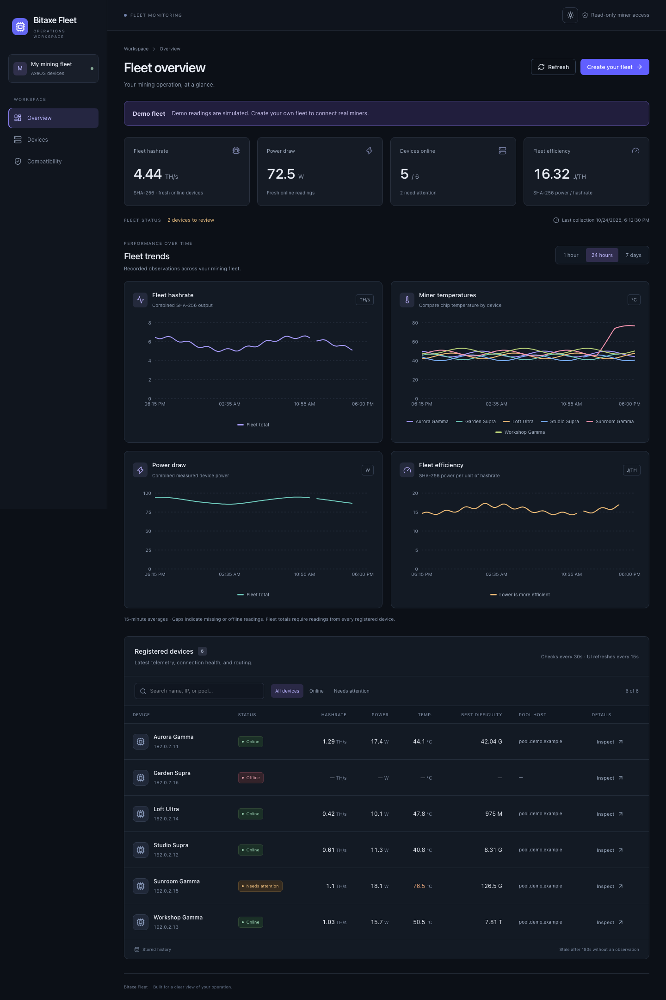

# Bitaxe Fleet

An independent, open-source fleet monitoring dashboard for Bitaxe miners running AxeOS. See connection health, hashrate, temperature, power, efficiency, and all-time best difficulty in one place.

Bitaxe Fleet is an independent project, not affiliated with or endorsed by the Bitaxe project. The Bitaxe name is used to identify the miners this dashboard supports.

Built with React, TypeScript, Fastify, SQLite/Drizzle, and Recharts. The collector reads telemetry independently of your browser. Pool configuration, firmware, restarts, and other miner controls stay in AxeOS.

## Dashboard preview



_Demo fleet with fictional miners and simulated readings. Your dashboard starts empty until you add your own miners._

## Quick start with Docker

Requirements: Docker Engine or Docker Desktop with Compose, and network access from the Docker host to your miners.

From the repository root:

```sh
docker compose up -d --build
docker compose logs -f collector
```

Open [http://127.0.0.1:3080](http://127.0.0.1:3080). Select **Add miner**, enter a private IPv4 address, check the detected miner, and confirm. No devices or sample telemetry are preloaded.

The API and collector share the `fleet-data` named volume in the `bitaxe-fleet` Compose project. Both restart automatically unless stopped. Stop them with `docker compose stop`; start them again with `docker compose up -d`. `docker compose down` also preserves the data volume. Adding `--volumes` deletes stored devices, settings, and history.

Port 3080 is bound to loopback. This application has no login: keep access local or behind authenticated access that you manage. Publishing this source on GitHub does not host the application. GitHub Pages cannot run the API or collector.

## Run with Node.js

Use Node.js 24 (see `.nvmrc`); Node.js 22.12 or newer is also supported. Install dependencies from the committed lockfile:

```sh
npm ci
npm run build
npm start
```

In a second terminal in the same repository, start the compiled collector:

```sh
npm run start:collector
```

Open [http://127.0.0.1:3080](http://127.0.0.1:3080). The API and collector are separate processes. Both must use the same `DATABASE_PATH` if you override it. Native Node processes do not automatically start after a reboot; use Docker Compose or your own service manager for unattended collection.

For development, run these in separate terminals:

```sh
APP_ORIGIN=http://127.0.0.1:5173 npm run dev:api
npm run dev:web
```

Vite serves port 5173 and proxies `/api` to port 3080. `npm run collect` performs a single collection cycle; `npm run collector` runs the source collector through `tsx`.

## Explore a demo fleet

After `npm ci` and `npm run build`, run:

```sh
npm run demo
```

Open [http://127.0.0.1:3081](http://127.0.0.1:3081). Six fictional miners include online, hot, and offline examples, with 24 hours of simulated trends. Readings update every 30 seconds without contacting miners. Demo mode is clearly labelled and read-only. Select **Create your fleet** to begin the welcome, compatibility, and first-miner setup wizard. The demo remains available while your own fleet opens in a separate workspace.

The demo defaults to its own database at `~/.local/share/bitaxe-fleet-demo/dashboard.sqlite`. It refuses to seed a database that already contains real devices or observations. Its persistent marker also prevents the collector from polling demo devices, even if started by mistake. An existing marked demo database continues simulating on subsequent API starts.

Your created fleet defaults to port 3082 and `fleet.sqlite` beside the demo database. Its collector runs inside the same Node process, starts only after the fleet is explicitly created, and resumes on later app starts. Keep that process running for collection to continue. Reopening the wizard reuses the same fleet instead of creating duplicate workspaces. Demo readings are never copied into it.

For a custom isolated environment, set `DEMO_MODE=1`, `PORT`, `APP_ORIGIN`, and a separate `DATABASE_PATH` when starting the API. Use `FLEET_PORT` and `FLEET_DATABASE_PATH` to configure the created workspace. The fleet port must be free and reachable in your browser; a reverse proxy or container setup must also route/publish that port. No separate collector process is needed for either the demo or a fleet created through its wizard. Normal standalone installations still use the API and collector processes described above.

## Manage your fleet

- **Add miner:** enter its private IPv4 address, check the connection, optionally choose a friendly name, then confirm. Checking alone does not register it. Verification expires after two minutes. Duplicate IP and MAC addresses are detected.
- **Nicknames:** select the pencil beside a miner's name on Overview or Devices. Names are saved in the dashboard and chart legends; identity and history are preserved.
- **Settings:** use the top-bar dialog to change the collection interval. The default is 30 seconds, with a range of 10–3,600 seconds. The running collector applies saved changes without a restart.
- **Inspect:** view device readings and recent history, or open the miner's own AxeOS interface.

Registration supports private IPv4 addresses. Hostnames, public/loopback/link-local addresses, custom ports, and redirects are rejected. Probes have request-duration and response-size limits. Browser writes require an application request header and an allowed origin.

## Miner compatibility

**Bitaxe Gamma 601 is the only maintainer-tested board so far.** Other Gamma revisions, Max, Ultra, Supra, Gamma Turbo, and other AxeOS-based miners are unverified. A compatible connection check is required before adding any miner; it does not certify every firmware or hardware combination.

| Miner                                                                  | Status            | Notes                                                                                                         |
| ---------------------------------------------------------------------- | ----------------- | ------------------------------------------------------------------------------------------------------------- |
| Bitaxe Gamma 601                                                       | Maintainer-tested | The tested board. Exact firmware-version coverage has not been catalogued; available readings may vary.       |
| Other Gamma revisions                                                  | Unverified        | Other 600-series revisions have not been tested with this dashboard.                                          |
| Bitaxe Max, Ultra, Supra, Gamma Turbo                                  | Unverified        | These AxeOS model families have not been tested with this dashboard.                                          |
| Other AxeOS-based miners                                               | Unverified        | A successful connection check validates required telemetry fields, not complete model/firmware compatibility. |
| Devices without compatible AxeOS telemetry, including USB-only devices | Not supported     | A reachable AxeOS monitoring API on a private IPv4 address is required.                                       |

See the in-app **Compatibility** page or [COMPATIBILITY.md](COMPATIBILITY.md) for the current list and requirements. The connection review identifies board revision 601 with a BM1370 ASIC as a match for the tested model. Missing or different board metadata stays unverified.

Use the sun/moon toggle in the top navigation bar to switch between dark and light themes. Your choice is saved in this browser; dark is the default.

## Collection and history

The collector reads each miner's `/api/system/info`, with at most four concurrent requests and a five-second default timeout. It waits the configured interval after each completed cycle, checks saved interval changes every second while waiting, and reloads the device inventory on each cycle. A database lease prevents overlapping collection runs.

The browser reads stored fleet data every 15 seconds and chart data every 60 seconds. Refreshing the page does not poll the miners. Collection continues with the browser closed while the collector process is running.

Failed polls are stored separately from successful readings. Data becomes stale after three collection intervals, with a minimum of 180 seconds. Missing measurements stay null, with gaps in charts rather than fabricated zeroes. Temperatures of 70°C or higher and zero hashrate produce warnings.

History retention defaults to **24 hours**. The 7-day chart window can be used if you explicitly increase `RETENTION_DAYS` before collecting that history; increasing retention cannot recover deleted samples. The UI displays SHA-256 hashrate in TH/s and AxeOS all-time best difficulty using K/M/G/T/P/E suffixes. Each miner is averaged before fleet totals are calculated.

## Configuration

`.env.example` documents available variables. For native Node, set these as process environment variables; the application does not automatically load `.env` files. Compose reads its own `.env` for variable substitution, and only passes variables explicitly listed in `compose.yaml`.

| Variable                | Default                                        | Purpose                                                                                 |
| ----------------------- | ---------------------------------------------- | --------------------------------------------------------------------------------------- |
| `HOST`                  | `127.0.0.1`                                    | Native API bind address; container uses `0.0.0.0`.                                      |
| `PORT`                  | `3080`                                         | Native API port; Compose publishes port 3080 on loopback.                               |
| `DATABASE_PATH`         | `~/.local/share/bitaxe-fleet/dashboard.sqlite` | Native SQLite file; containers use `/data/dashboard.sqlite`.                            |
| `POLL_INTERVAL_SECONDS` | `30`                                           | Initial collection interval until one has been saved in Settings. Use 10–3,600 seconds. |
| `MINER_TIMEOUT_MS`      | `5000`                                         | Per-miner request timeout.                                                              |
| `RETENTION_DAYS`        | `1`                                            | History retention, applied by the collector.                                            |
| `APP_ORIGIN`            | `http://127.0.0.1:3080`                        | Browser origin allowed to update dashboard inventory and settings.                      |

Saved collection settings override the environment default. The collector needs LAN access to miner addresses; a cloud server generally cannot reach miners on a home network without additional networking.

## Storage, backup, and upgrade

SQLite stores registered devices, nicknames, settings, and observations. Keep it on local storage; WAL mode requires local filesystem semantics. Never commit databases, WAL/SHM files, backups, `.env`, or real fleet configuration. Ignore rules cover these files.

Use SQLite's online backup API for a running installation. For an offline file copy, stop both API and collector first and preserve any WAL/SHM files alongside the database. Store backups outside the repository and test restoration before depending on them.

For an upgrade, back up first, update the source, rebuild, and restart both processes. With Compose, run `docker compose up -d --build` using the same project name and data volume. Schema upgrades run transactionally without replacing existing device data.

## Development checks

```sh
npm run format:check
npm run typecheck
npm test
npm run build
npm audit --omit=dev --audit-level=high
```

CI runs formatting, type checks, tests, and builds on Node.js 22 and 24, plus a fresh Docker Compose smoke test. Test fixtures use synthetic telemetry and private example addresses; they do not contact real miners. See [CONTRIBUTING.md](CONTRIBUTING.md), [SECURITY.md](SECURITY.md), and the [publication checklist](PUBLISHING.md).

## HTTP API

| Method | Path                               | Purpose                                                                |
| ------ | ---------------------------------- | ---------------------------------------------------------------------- |
| GET    | `/healthz`                         | Process liveness.                                                      |
| GET    | `/readyz`                          | Database availability.                                                 |
| GET    | `/api/fleet`                       | Devices, latest readings, health, and collection interval.             |
| GET    | `/api/miners/:id/history?hours=24` | Device history, capped at 10,000 observations and 168 requested hours. |
| GET    | `/api/fleet/trends?hours=24`       | Chart data for 1, 24, or 168 hours.                                    |
| POST   | `/api/fleet/create`                | Create or reopen a separate real fleet from the demo wizard.           |
| POST   | `/api/miners/probe`                | Verify an address and obtain a short-lived registration token.         |
| POST   | `/api/miners`                      | Register a verified miner with an optional friendly name.              |
| PATCH  | `/api/miners/:id`                  | Update a dashboard nickname.                                           |
| GET    | `/api/settings`                    | Read the collection interval.                                          |
| PATCH  | `/api/settings`                    | Save an integer collection interval from 10 to 3,600 seconds.          |

There are no endpoints for changing miner hardware settings.

## License

Licensed under the [MIT License](LICENSE). Copyright (c) 2026 masaruytch. Third-party dependencies retain their own licenses; see [THIRD_PARTY_NOTICES.md](THIRD_PARTY_NOTICES.md).
